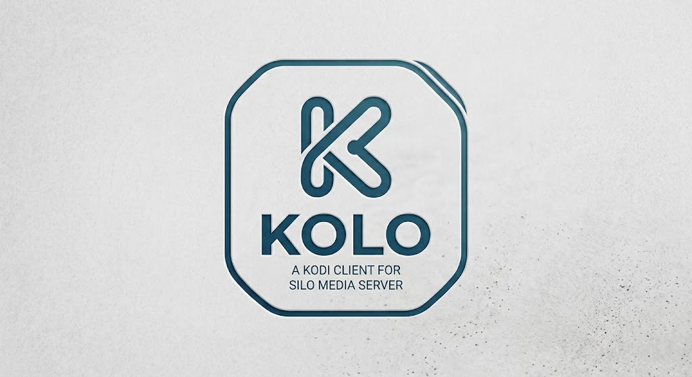

# Kolo

A community-developed Kodi client for [Silo Media Server](https://github.com/Silo-Server/silo-server).

<p align="center"></p>

**Independent community project:** this add-on is not affiliated with, endorsed by, sponsored by, or an official product of Silo Media L.L.C. or the Kodi Foundation. **No media, streams, or subscriptions are included or supplied.** You must configure access to your own Silo Server and provide your own media access.

**Upgrading from the previous add-on?** Kolo uses a new add-on ID (`plugin.video.kolo`), so Kodi will not update an older install automatically. Install the Kolo repository (see below), install Kolo, sign in again, then remove the old add-on.

---

## Discord Server

join for help or feedback

https://discord.gg/dyae2tv7Qs

---

## Kodi Repository Address

https://liam8888999.github.io/KOLO/

---

## ✨ Features

### Libraries, browsing and discovery

* Browse movies, TV series, seasons, episodes and TMDB Box Sets from libraries where Box Set grouping is enabled on the server.
* Open Box Sets to view their movies in release order, with the normal movie artwork, watched/resume state and playback actions.
* Search your library, including people and matching Box Sets, and browse person-related media where supported by the server.
* Browse Silo Home sections and Discover recommendations.
* View personal lists including Watchlist, Favourites and history, and access personal collections.
* Browse large libraries with automatic API pagination rather than manually navigating page numbers.
* Inspect alternate file versions before playback, including available media/quality details.

### Playback

* Play media through Kodi using Silo's playback API, including server-planned direct play and transcoding.
* Adaptive quality switching uses the quality options published by Silo Server and can step down when sustained buffering is detected.
* Optional **Only allow direct play** setting disables adaptive quality switching and rejects playback plans that require transcoding or HLS adaptation.
* Report Kodi playback progress to Silo Server approximately every five seconds, so progress is shared with other clients.
* Log Silo's playback decision reason, source/output dynamic range, selected transformations and degradation codes to make unexpected transcoding diagnosable.
* Use the latest server-side resume position with Kodi's native Resume / Start from beginning prompt.
* Report playback capabilities to Silo Server, including supported video/audio and display HDR details where Kodi exposes them, to help the server plan playback.
* Identify Dolby Vision source profiles and metadata across legacy, streaming and disc-oriented formats; do not infer decoder support from the display HDR label.
* Attempt the original Dolby Vision source in Kodi's native player first for every detected profile, including Profiles 5 and 7; if Kodi reports a decoder/startup failure, automatically request a profile-aware alternative from Silo and preserve the current playback position.
* Keep the narrower Profile 8 base-layer claim restricted to proven single-layer Main 10 HEVC sources with supported compatibility metadata. Other profiles are not falsely advertised as HDR10 base-layer sources.
* Respect **Only allow direct play**: when enabled, no remux/transcode fallback is requested.
* Negotiate server-supported HLS subtitle renditions so compatible embedded text tracks can be offered by Kodi's native player.
* Skip available intro, recap and credits segments. You can choose prompts or enable automatic skipping separately for intros, recaps and credits in the add-on settings.
* Support server-side playback termination, which stops the active Kodi stream when Silo Server revokes or terminates its session.

### Accounts, profiles and connectivity

* Sign in using a username/password or device code when supported by the server.
* Switch between PIN-protected profiles; the active profile is shown in the root menu, and closing the profile chooser keeps the current profile.
* Save multiple Silo servers/accounts, switch between them, and reconnect after logging out without re-entering saved account details.
* Show a server's custom name in the server switcher when available, falling back to its URL for the default server name.
* Join an existing Silo Watch Party and synchronise playback with the room.

## 📋 Requirements

You will need:

* [Kodi](https://kodi.tv/) installed on your device
* A running **Silo Server** instance
* Network connectivity between Kodi and Silo Server

Silo Server is available here:

https://github.com/Silo-Server/silo-server

---

# 🚀 Installation

The Kolo repository can be installed directly from Kodi without manually downloading the repository ZIP.

## 1. Enable Unknown Sources

Kodi needs permission to install add-ons from ZIP files.

From the Kodi home screen, go to:

```text
Settings
  → System
    → Add-ons
      → Unknown sources
```

Enable **Unknown sources** and confirm the warning.

You only need to do this once.

---

## 2. Add the Kolo Repository to Kodi's File Manager

Open:

```text
Settings
  → File Manager
```

Select:

```text
Add source
```

Enter the following address:

```text
https://liam8888999.github.io/KOLO/
```

For the name, enter:

```text
Kolo Repository
```

Then select **OK**.

You should now have a file source called:

```text
Kolo Repository
```

in Kodi's File Manager.

---

## 3. Install the Repository ZIP

Return to:

```text
Add-ons
  → Add-on browser
  → Install from zip file
```

Select:

```text
Kolo Repository
```

You should see the repository ZIP file.

Select the ZIP file, for example:

```text
repository.kolo-1.0.zip
```

Kodi will install the **Kolo Repository** directly from the hosted repository.

> **You do not need to download or extract the ZIP file manually.**

---

## 4. Install the Kolo Add-on

Once the repository has been installed, go to:

```text
Add-ons
  → Add-on browser
  → Install from repository
```

Select:

```text
Kolo Repository
```

Then select the **Kolo** add-on and choose:

```text
Install
```

Kodi will install the Kolo add-on and any required dependencies.

---

# ⚙️ Configuration

After installing the add-on, open Kolo and sign in to your Silo Server.

First it will ask for your server address

For example:

```text
http://192.168.1.100:8080
```

Replace this with the address and port of your own Silo Server.

**Important:** Use the Silo app/API URL, not the server's Jellyfin-compatibility URL.

### Local Silo installation

If Silo Server is running on the same device as Kodi, you may be able to use:

```text
http://localhost:8080
```

If Silo is running on another device, use that device's IP address or hostname instead.

For example:

```text
http://192.168.1.50:8080
```

Follow the sign-in prompts. Depending on the server, you can sign in with a device code or a username and password, then choose your profile and enter its PIN if prompted.

---

# 🎬 Using Kolo

Once configured, open **Kolo** from Kodi's add-ons.

The add-on communicates with your Silo Server and displays the media available through it.

Browse your available media and select a movie or episode to begin playback.

The basic architecture is:

```text
                    ┌─────────────────┐
                    │      Kodi       │
                    │                 │
                    │   Kolo Add-on   │
                    └────────┬────────┘
                             │
                             │ API
                             ▼
                    ┌─────────────────┐
                    │   Silo Server   │
                    │                 │
                    │  Media Server   │
                    └────────┬────────┘
                             │
                             ▼
                    ┌─────────────────┐
                    │  Media Sources  │
                    └─────────────────┘
```

Kodi provides the interface and playback, while Silo provides access to the media.

---

# 🔄 Updates

The Kolo add-on is distributed through a Kodi repository, allowing new versions to be delivered through Kodi without manually reinstalling the add-on.

To manually check for updates:

```text
Add-ons
  → My add-ons
  → Kolo
  → Check for updates
```

If automatic add-on updates are enabled in Kodi, updates may be installed automatically.

The repository is hosted at:

https://liam8888999.github.io/KOLO/

---

# 🛠️ Troubleshooting

## Repository will not install

Make sure the File Manager source was added correctly:

```text
https://liam8888999.github.io/KOLO/
```

The source should be named:

```text
Kolo Repository
```

Then check:

```text
Add-ons
  → Add-on browser
  → Install from zip file
  → Kolo Repository
```

The repository ZIP should be visible there.

---

## Kolo does not appear in the repository

Check that:

1. The Kolo repository installed successfully.
2. You selected **Install from repository** after installing it.
3. Kodi has network access.
4. The repository ZIP is the current version.

Restarting Kodi can also force Kodi to refresh its add-on information.

---

## Kodi cannot connect to Silo Server

Check that Silo Server is running and accessible from the Kodi device.

For example, if Silo is running at:

```text
http://192.168.1.100:8080
```

make sure the Kodi device can reach that address.

Common causes include:

* Incorrect Silo Server address
* Incorrect port
* Silo Server is not running
* Firewall blocking the connection
* Kodi and Silo being on isolated networks
* Incorrect hostname or IP address

---

## Media appears but will not play

If the library can be browsed but playback fails, first verify that the media can be accessed successfully through Silo Server.

If it still wont play go to settings and enable "only allow direct play" under the play back settings which will disable transcoding completely and hopefully give a better experience

If that still doesnt work then check the Kodi log for additional information.

When reporting a playback problem, include the relevant Kodi log output where possible.

---

## The addon is taking a long time to load my libraries

Sometimes if connection to your library is a bit slow it can take kodi longer to load the libraries into the addon, one way to help improve this is to set pagination to a smaller number in the addon settings

---

# 🧑‍💻 Development

The Kolo add-on is contained in:

```text
plugin.video.kolo/
```

A typical add-on structure is:

```text
plugin.video.kolo/
├── addon.xml
├── addon.py
└── ...
```

The repository contains the metadata required for Kodi to discover and install the add-on.

---

# 📦 Kodi Repository

The repository is hosted using GitHub Pages:

**https://liam8888999.github.io/KOLO/**

Kodi uses the repository to:

* Discover the Kolo add-on
* Determine the available version
* Download the add-on
* Download required dependencies
* Receive future updates

---

# 🐛 Issues & Feature Requests

If you encounter a bug or have an idea for improving the add-on, please open an issue on GitHub.

When reporting a problem, include as much useful information as possible:

* Kodi version
* Operating system
* Silo Server version
* Kolo add-on version
* Description of the problem
* Relevant Kodi log output

Please remove passwords, API keys, private URLs and other sensitive information before posting logs.

---

# 🔗 Related Projects

### Silo Server

The server used by this add-on to provide access to your media.

https://github.com/Silo-Server/silo-server

---

## ⭐ Support the Project

If you find the Kolo add-on useful, consider giving the project a ⭐ on GitHub.

Bug reports, feature requests and contributions are welcome.
